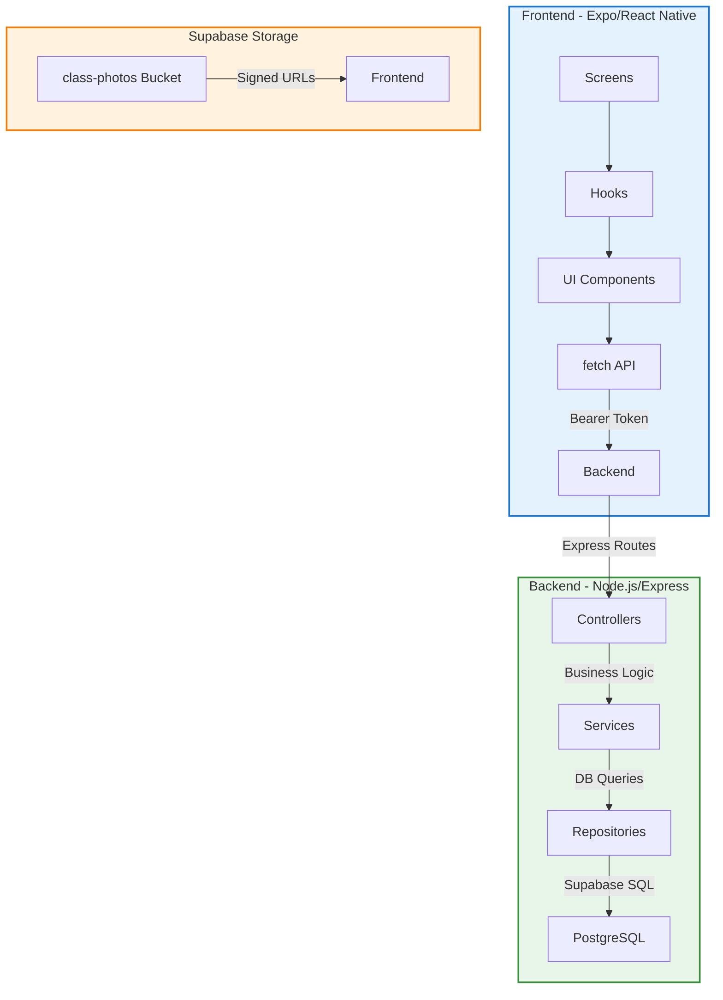
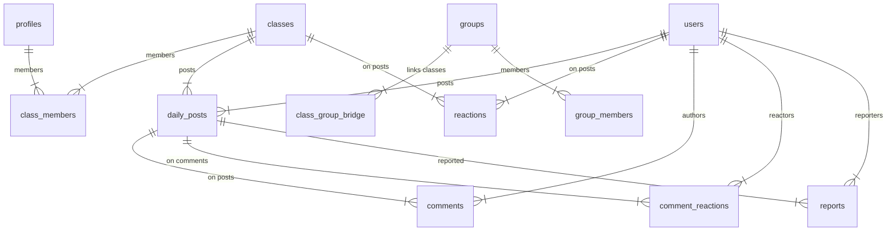

# 02_SYSTEM_ARCHITECTURE.md

## Overall System Architecture

Memora follows a **clean client-server architecture** with Supabase as the backend-as-a-database-and-auth-service. The system is designed with a strongly separated boundary where the frontend is a replaceable presentation layer.

### High-Level Architecture Diagram



### Component Relationships

1. **Frontend → Backend**: All communication goes through HTTP fetch calls to `/api/*` endpoints
2. **Authentication**: Bearer tokens from Supabase Auth are sent in `Authorization: Bearer <token>` header
3. **Authorization**: Backend `requireAuth` middleware verifies token via `supabase.auth.getUser()`, attaches `req.userId`
4. **Data Access**: Supabase Row Level Security (RLS) policies enforce access control at the database level
5. **Storage**: Photos stored in private `class-photos` bucket; accessed via short-lived signed URLs

### Frontend Architecture

The frontend follows the design specification from `IDEAS_Deva`:

```
Frontend Structure:
├── app/                    ← Next.js/app Router pages & layouts
│   ├── (auth)/            ← Auth flow
│   ├── (onboarding)/      ← Onboarding flow
│   ├── (tabs)/            ← Bottom tab navigation
│   └── layouts/           ← Global layouts
├── components/ui/         ← Reusable UI components (buttons, cards, etc.)
├── hooks/                 ← Custom React hooks (useAuth, useClass, useNotifications)
├── constants/             ← Theme, prompts, spacing, typography
├── lib/                   ← Utility libraries (photo-draft, supabase clients)
└── app.json / eas.json    ← Expo configuration
```

Key frontend design principles (from IDEAS_Deva Section 51):
- Frontend is a **replaceable presentation layer**
- No direct database access in components
- Business logic lives in services/hooks, not UI components
- Hooks/View Models → API Services → Backend → Database

### Backend Architecture

The backend follows a **clean service architecture** (from IDEAS_Deva Section 3):

```
Backend Structure:
├── src/
│   ├── controllers/         ← Thin HTTP handlers
│   │   ↓ delegates to services
│   ├── services/            ← Business logic (not in controllers)
│   │   ↓ uses repositories
│   ├── repositories/        ← Direct DB operations
│   │   ↓ uses Supabase client
│   ├── routes/              ← Express route composition
│   ├── middleware/          ← Auth, error handling
│   ├── types/               ← Shared TypeScript interfaces
│   ├── validators/          ← Zod input validation
│   └── lib/                 ← Utilities (supabase client)
└── dist/                    ← Compiled output
```

**Separation of Concerns**:
- **Controllers**: Parse HTTP request, validate input, delegate to services
- **Services**: Contains business rules (daily post enforcement, class membership checks, etc.)
- **Repositories**: Abstract database operations (insert, select, update, delete)
- **Middleware**: Cross-cutting concerns (authentication, error handling)

### Database Architecture

The database is **Supabase PostgreSQL** with the following key entities:



Key tables and relationships:
- **profiles**: User profile data (linked to auth.users)
- **classes**: Group/classes entity with join codes
- **class_members**: Many-to-many relationship between users and classes
- **daily_posts**: The core photo posting table with unique constraint on (class_id, user_id, post_date)
- **reactions**: User reactions to posts (unique on post_id + user_id + reaction_type)
- **comments**: Comment threads on posts
- **comment_reactions**: Reactions on comments
- **reports**: Report submissions for moderation
- **notifications**: Notification records
- **device_tokens**: Expo push notification tokens
- **admin_actions**: Admin activity log
- **groups**: Extended group concept (from migration 004)
- **group_members**: Group membership
- **time_capsules**: Time capsule entities
- **yearbooks**: Yearbook generation records

### API Architecture

RESTful endpoints under `/api/` prefix:

```
GET    /api/health           ← Health check
GET    /api/ready            ← Supabase connectivity check
POST   /api/auth/login       ← Login (handled by Supabase)
POST   /api/auth/register    ← Register (handled by Supabase)
POST   /api/auth/logout      ← Logout (handled by Supabase)
GET    /api/auth/me          ← Get current user
POST   /api/classes          ← Create class
POST   /api/classes/join     ← Join class by code
GET    /api/classes          ← Get user's classes
GET    /api/classes/:id      ← Get class details
GET    /api/classes/:id/members ← Get class members
POST   /api/daily-posts      ← Create daily post
GET    /api/daily-posts/feed ← Get today's feed
PATCH   /api/daily-posts/:id ← Update caption
DELETE  /api/daily-posts/:id ← Delete post
POST   /api/reactions        ← Toggle reaction on post
POST   /api/posts/:id/comments ← Create comment
GET    /api/posts/:id/comments ← Get comments for post
PATCH   /api/comments/:id    ← Update comment
DELETE  /api/comments/:id    ← Delete comment
POST   /api/comments/:id/reactions ← Toggle comment reaction
GET    /api/prompts/today    ← Get today's prompt
```

All API endpoints (except auth) require Bearer token authentication via `requireAuth` middleware.

### Authentication and Authorization Architecture

**Authentication Flow**:
1. User signs in via Supabase Auth (email/password)
2. Supabase returns session with access token
3. Frontend stores token and sends it as `Authorization: Bearer <token>` header
4. Backend `requireAuth` middleware verifies token:
   - Extracts Bearer token from `authorization` header
   - Calls `supabase.auth.getUser(accessToken)`
   - On success: attaches `req.userId = data.user.id`, calls `next()`
   - On failure: returns 401 "Authorization bearer token is required" or "Access token is invalid or expired"

**Authorization Flow**:
1. `requireAuth` middleware attaches `req.userId` to authenticated requests
2. Services and repositories check class/group membership before operations
3. Supabase Row Level Security (RLS) policies enforce at database level:
   - `class_members`: Users can read their own memberships
   - `daily_posts`: Class members can read/create their own posts
   - `storage.objects`: Members can upload/remove their own class photos (via foldername check)

**Role-Based Access**:
- **Owner**: Created class, can manage members, settings
- **Admin**: Can manage group settings, members, moderation
- **Member**: Can post, react, comment (within class constraints)

### State Management

**Frontend State**:
- **React useState**: Screen-level UI state
- **AsyncStorage**: Local persistence for photos, profiles, collections, favorites
- **Supabase session**: Auth state (global)
- **No React Query/TanStack Query**: Despite being in package.json, not actively used

**Backend State**:
- **Express session**: Not used (token-based auth)
- **Supabase managed**: All state in database
- **No in-memory caching**: Each request hits the database

### Routing Architecture

**Frontend (Expo Router)**:
- File-based routing with support for deep linking
- `(auth)` prefix for auth screens
- `(onboarding)` prefix for onboarding flow
- `(tabs)` prefix for bottom tab navigation
- Deep link format: `/(tabs)/home`, `/class/[classId]`, `/post/[postId]`

**Backend (Express)**:
- All routes prefixed with `/api`
- Resource-based routing pattern
- Route parameters for IDs (`/classes/:id`, `/daily-posts/:id`)
- Query parameters for filtering (`/daily-posts/feed?classId=x`)

### Middleware Architecture

Express middleware stack (in order):

1. **CORS middleware**: Configures cross-origin requests from frontend URL
2. **JSON body parser**: `express.json({ limit: "10mb" })`
3. **`requireAuth` middleware**: Verifies Bearer token, attaches `req.userId`
4. **Route handlers**: Controllers that process requests
5. **`errorHandler` middleware**: Centralized error handling, returns consistent error format

### Service Layer

The service layer contains business logic, keeping controllers thin:

**Post Service** (`post.service.ts`):
- `createDailyPost()`: Enforces one-photo-per-day rule, checks class membership, creates post
- `getTodayFeed()`: Gets today's feed with reactions, comments, signed URLs
- `updateCaption()`: Validates ownership before updating
- `deletePost()`: Validates ownership or class membership before deletion
- `toggleReaction()`: Checks membership, toggles reaction in database
- `createComment/createCommentReaction/getComments/updateComment/deleteComment`: Full comment CRUD

**Class Service** (`class.service.ts`):
- `createGroup/createClass`: Create new group/class with owner membership
- `joinGroupByCode/joinClassByCode`: Join via invite code
- `getGroupMembers/getClassMembers`: List members with membership check
- `removeMember`: Remove member (admin check)

**Prompt Service** (`prompt.service.ts`):
- `getTodayPrompt()`: Gets or creates today's prompt

### External Services and Integrations

1. **Supabase Authentication**: Email/password sign in, session management, Bearer token verification
2. **Supabase PostgreSQL**: All application data storage
3. **Supabase Storage**: Private photo bucket (`class-photos`) with signed URL access
4. **Expo Image Picker**: Camera and photo library access
5. **Expo Image Manipulator**: Image resizing and compression
6. **Expo AV**: Camera and audio (imported but not fully configured)
7. **AsyncStorage**: Local data persistence

### Communication Between Modules

**Frontend → Backend Communication**:
```
Screen/Component
  ↓ uses useHook() or direct fetch
Hook/Service function
  ↓ constructs HTTP request
fetch(apiEndpoint, { method, headers, body })
  ↓ sends Bearer token from supabase.auth.getSession()
Express Server
  ↓ requireAuth middleware verifies token
  ↓ controller processes request
  ↓ service contains business logic
  ↓ repository executes Supabase SQL
  ← returns JSON response
  ← frontend updates UI state
```

**Backend → Database Communication**:
```
Service method
  ↓ repository method
supabase.from('table').select/insert/update/delete()
  ← PostgreSQL query execution
  ← returns data (or error)
  ← service processes results
  ← controller returns JSON response
```

**Storage Flow**:
```
Frontend selects/compresses photo
  ↓ generates signed upload URL via StorageService.createSignedUploadUrl()
  ← returns signedUrl + token + path
Frontend uploads photo to signed URL
  ← Supabase stores photo in private bucket
  ← photo_path stored in daily_posts table
Backend generates signed download URL
  ↓ returns temporary URL to frontend
Frontend displays photo using signed URL
  ← URL expires after configurable period (3600s default)
```

## Why This Architecture?

1. **Separation of concerns**: Frontend presentation vs. backend business logic vs. database persistence
2. **Security**: RLS policies + bearer token auth + private storage bucket
3. **Scalability**: Supabase handles PostgreSQL scaling; signed URLs offload storage serving
4. **Maintainability**: Clear layers (controller → service → repository) make changes predictable
5. **Testability**: Services and repositories can be unit-tested independently
6. **Frontend replaceability**: Per IDEAS_Deva Section 51, UI can be rewritten without touching API/business logic
7. **Permission enforcement**: Dual enforcement - app-level (service checks) + database-level (RLS policies)